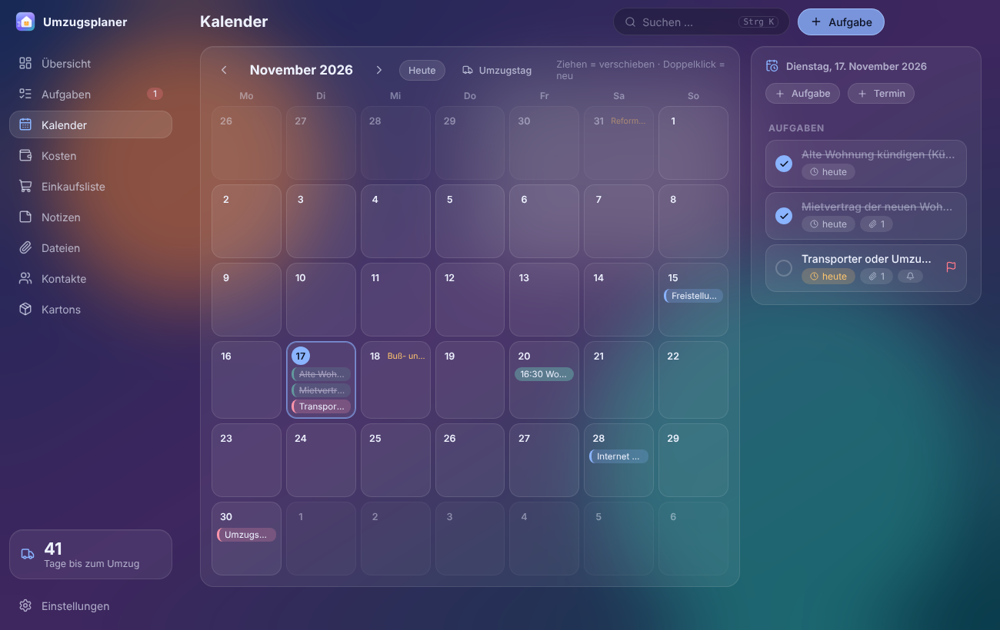
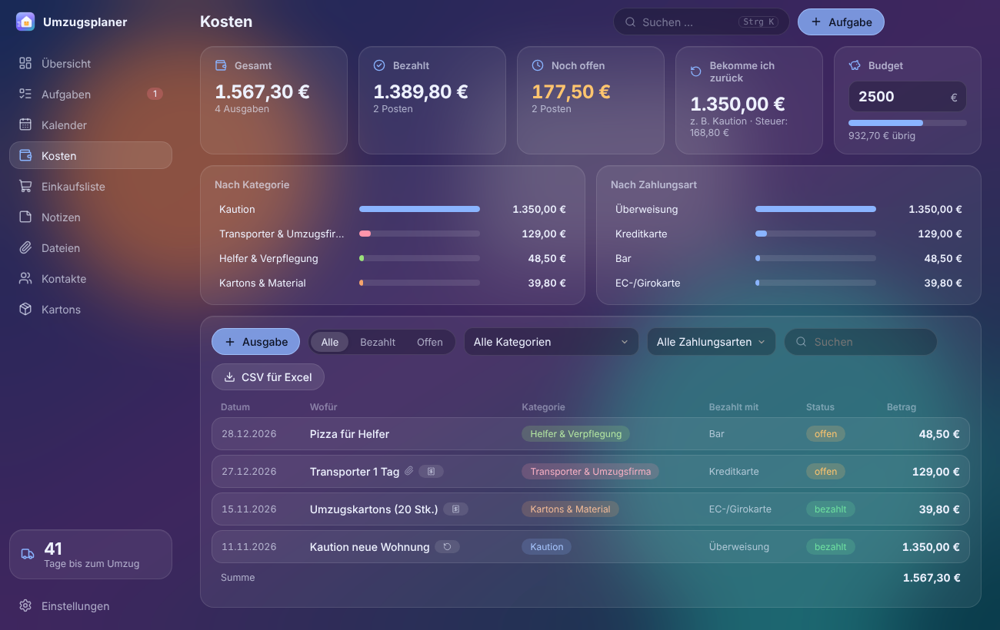
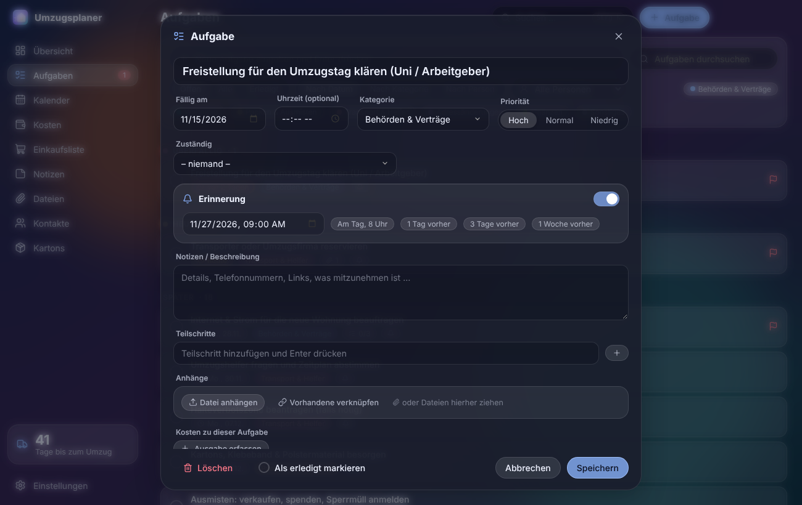

# 📦 Umzugsplaner

Windows-App, die einen Umzug planbar macht: Aufgaben mit Fristen und Erinnerungen, Kalender, Kosten,
Einkaufsliste, Notizen, Kontakte, Kartons und Dateien. Alles an einem Ort, im Glasdesign von Windows 11.


## Funktionen

- **Aufgaben** mit Fälligkeit, Uhrzeit, Erinnerung, Priorität, Kategorie, Teilschritten, Notizen und Anhängen.
  Jede Aufgabe kann einer Person aus den Kontakten zugeordnet werden, danach lässt sich filtern.
- **Fertige Umzugs-Checkliste** mit ca. 22 typischen Punkten (Kündigung, Ummeldung, Zählerstände,
  Adressänderungen …). Die Fristen werden aus dem Umzugsdatum berechnet.
- **Kalender** mit Aufgaben, Terminen und Feiertagen (Sachsen). Aufgaben lassen sich per Ziehen verschieben.
- **Kosten** mit Betrag, Zahlungsart, Kategorie, Status und Belegen. Summen nach Kategorie und Zahlungsart,
  Budget und CSV-Export für Excel.
- **Einkaufsliste**: Abgehakte Einkäufe werden automatisch als Ausgabe erfasst.
- **Erinnerungen** als Windows-Benachrichtigung und morgendliche Zusammenfassung. Optional zusätzlich **aufs Handy**
  über [ntfy](https://ntfy.sh). Erinnerungen werden bis zu 3 Tage im Voraus eingeplant und kommen damit auch an,
  wenn der PC aus ist.
- **Notizen, Kontakte, Kartonliste** („Wo ist der Wasserkocher?“) und **Dateien** per Drag & Drop.
- Suche (Strg+K), helles und dunkles Design, Akzentfarben, einstellbare Glas-Deckkraft, tägliche Sicherungen.

| Kalender | Kosten | Aufgabe |
|---|---|---|
|  |  |  |

> Die Screenshots stammen aus der Browser-Vorschau mit Beispieldaten. In der App scheint der echte
> Desktop-Hintergrund durch (Windows 11 Acrylic).

## Daten

Alles wird lesbar im Programmordner gespeichert: `daten\umzug.json` (JSON) und `anhaenge\` (Dateien).
Änderungen an der JSON-Datei von außen übernimmt die laufende App sofort. Damit kann man die Daten auch
per Skript oder KI bearbeiten. Das Datenformat ist in [`LIES-MICH.md`](LIES-MICH.md) beschrieben.
Es gibt keine Cloud und kein Konto. Nur wenn ntfy aktiviert ist, gehen Erinnerungstexte an den ntfy-Server.

## Bauen

Voraussetzung: [Node.js](https://nodejs.org) ab Version 22.

```bash
cd quellcode
npm install
npm run paket     # fertige App in dist/Umzugsplaner (lädt Electron für Windows)
npm run build     # nur die Oberfläche nach app/ bauen
npm run dev       # Oberfläche im Browser mit Beispieldaten
```

`dist/Umzugsplaner` ist ein portabler Ordner. Einfach irgendwohin kopieren und `Umzugsplaner.exe` starten.

## Aufbau

| Pfad | Inhalt |
|---|---|
| `app/main.js` | Hauptprozess (Electron): Speichern, Dateiüberwachung, Anhänge, Erinnerungen, ntfy, Infobereich |
| `app/preload.js` | Brücke zur Oberfläche (`window.umzug`) |
| `quellcode/` | Oberfläche in Svelte 5 (+ Vite), Paket-Skript, Bootstrap für `resources/app.asar` |

Technik: Electron 45 · Svelte 5 · Vite · Lucide-Icons

## Lizenz

GPL-3.0, siehe [LICENSE](LICENSE).

Design by Mforone · Entwicklung Mforone mit Claude
